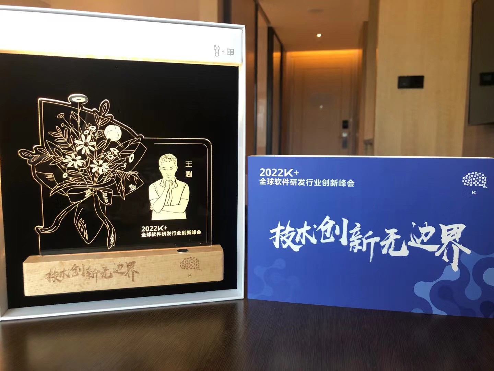

# UI 自动化智能解析之路

2022 年 8 月 20 日，我受邀在深圳举办的 K+ 全球软件研发行业创新峰会演讲。大会把这场分享列在「低代码与数字化生态创新」专题，议程标题为《UI 自动化智能解析之路》。现场课件题为《58 场景下 UI 自动化智能解析实践》，结合 58 的业务场景介绍 UI 解析与代码生成实践。[大会讲师页](http://www.2022shenzhen.keylinkcon.com/h-col-183.html) · [大会日程](http://www.2022shenzhen.keylinkcon.com/col.jsp?id=164)

## 现场课件

[阅读 PDF](58场景下UI自动化智能解析实践.pdf?raw=1) · [下载 PowerPoint（PPTX）](58场景下UI自动化智能解析实践.pptx?raw=1)

## 峰会海报与讲师纪念牌

海报底部的二维码通往峰会官网。[峰会海报原图](poster.jpeg) · [讲师纪念牌照片](souvenir.jpg)

[返回个人主页](../../README.md)
