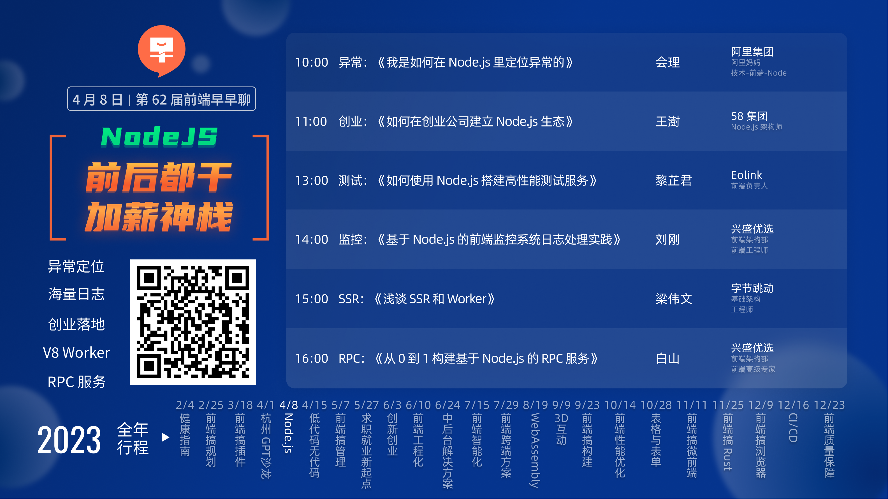

# 如何在创业公司建立 Node.js 生态

2023 年 4 月 8 日，我受邀参加第 62 届前端早早聊 Node.js 专场，在 11:00 的「创业」场次分享转转的实践。内容来自我和团队从零搭建 Node.js 生态的经历，涉及企业级框架、开发规范，以及服务上线后的发布与监控。

[活动页](https://www.zaozao.run/conf/c62) · [本届回放入口](https://www.zaozao.run/video/c62)

## 议程海报

海报列出了当天六场分享。扫描左下方的二维码即可打开本届活动页。[查看海报原图](agenda.png)

[返回个人主页](../../README.md)
